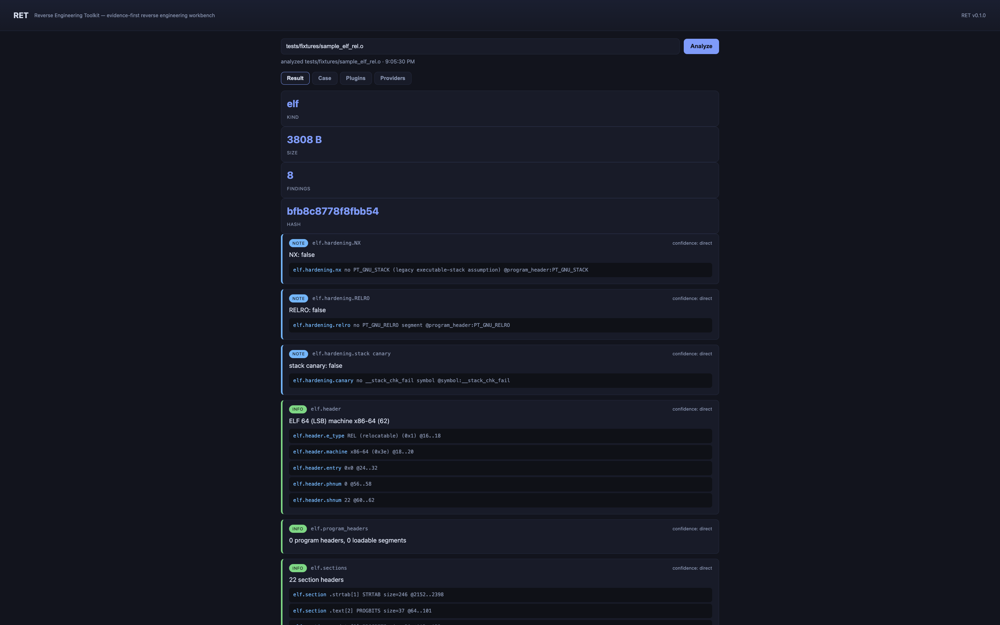
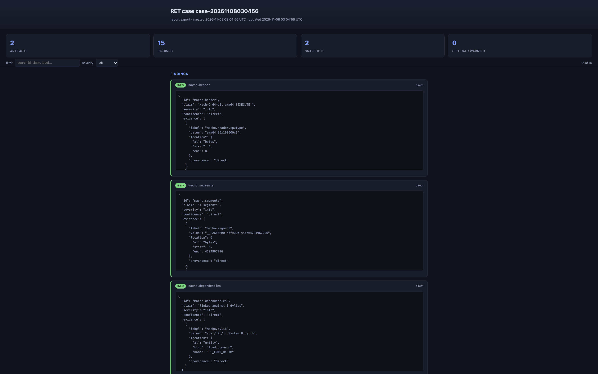
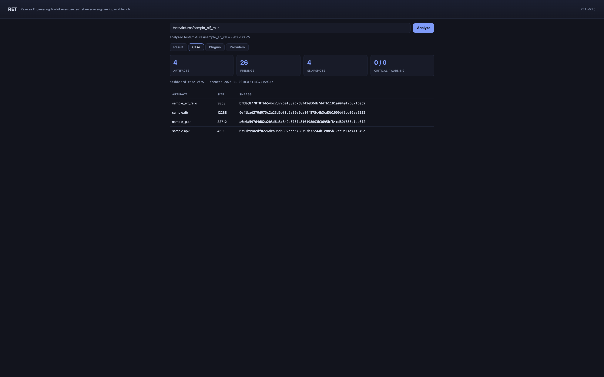
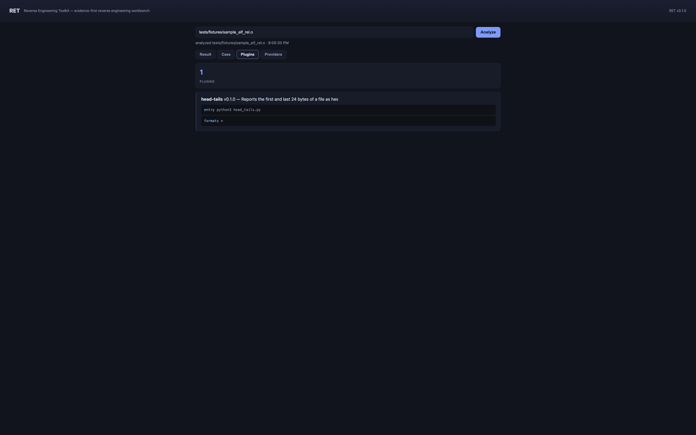

# RET — Reverse Engineering Toolkit

**The local, evidence-first reverse engineering workbench.**

RET analyzes binaries, apps, archives and network captures **entirely on your machine** — and, unlike a plain report generator, it records the *proof* behind every conclusion. Each finding carries its **byte-level evidence**, a **confidence** rating, and an honest list of **limitations**, so you (or your AI agent) can always trace a claim back to the exact bytes that support it.

```
ret analyze ./malware.bin --record
ret compare before.apk after.apk
ret batch ./vendor --record
ret serve            # embedded web dashboard
ret mcp              # expose the same analysis to your agent (MCP)
ret report           # export the case as Markdown or standalone HTML
```



RET is an **original implementation written from scratch in Rust**. All format analyzers are engine-free, hand-written parsers — no bindings to third-party analysis libraries. GNU objdump / radare2 are used *only* when you explicitly ask for disassembly. The whole tool compiles to a single ~2.2 MB static binary with **zero runtime dependencies**.

---

## Table of contents

1. [What is RET?](#what-is-ret)
2. [Why RET is useful](#why-ret-is-useful)
3. [What makes RET unique](#what-makes-ret-unique)
4. [RET vs. leading commercial / open-source tools](#ret-vs-leading-commercial--open-source-tools)
5. [What RET understands](#what-ret-understands)
6. [Installation](#installation)
7. [60-second quick start](#60-second-quick-start)
8. [Full walkthrough](#full-walkthrough)
9. [Command reference](#command-reference)
10. [The case file](#the-case-file)
11. [Agent integration (MCP)](#agent-integration-mcp)
12. [Writing a plugin](#writing-a-plugin)
13. [Security & privacy model](#security--privacy-model)
14. [Development](#development)
15. [Project layout](#project-layout)
16. [License](#license)

---

## What is RET?

RET (**R**everse **E**ngineering **T**oolkit) is a command-line tool, a web dashboard, and an MCP server that answers the question every reverse engineer, incident responder, and supply-chain auditor asks:

> *“What is this file — and can you prove it?”*

You point it at a binary, an app bundle, an archive, a SQLite database, an AI model file, or a captured HTTP session. RET parses it with hand-written, engine-free Rust parsers and produces a structured report where **every claim is backed by evidence**:

- a **claim** (“ELF 64-bit, x86-64, NX disabled”),
- **evidence** (observed facts, each tagged with the byte range it came from, e.g. `elf.hardening.nx = false @ bytes 0x10..0x12`),
- a **confidence** rating — `direct` (observed), `derived` (computed), or `inferred` (heuristic),
- **limitations** — what the analysis *could not* establish.

Everything is computed **locally**. Artifacts are never modified, executed, or uploaded. Nothing leaves your machine.

RET speaks the same language as modern AI agents: it ships a built-in **MCP server** (11 tools) so Claude, GPT-based agents, or any MCP client can analyze artifacts the same way the CLI does — with the same evidence model and the same safety rails.

## Why RET is useful

| You are… | RET helps you… |
|---|---|
| **An incident responder** | Triage a suspicious sample *air-gapped*: identify format, entry points, linked libraries, embedded strings, and hardening — then export a self-contained HTML report for the case file. |
| **A supply-chain auditor** | Scan a whole `vendor/` directory in parallel, record snapshots, and get a precise structural diff of what changed between two versions of a dependency — byte changes vs. metadata-only changes. |
| **An app-security engineer** | Inspect Electron/JS apps for boundaries (main / preload / renderer), ASAR contents, routes, and sourcemaps; check ELF/PE/Mach-O hardening (NX, RELRO, canary, PIE). |
| **A reverse engineer** | Get a fast, honest inventory of any artifact before you commit to opening it in IDA/Ghidra/Binary Ninja — and keep an append-only case file of everything you observed. |
| **An AI-agent builder** | Give your agent 11 structured MCP tools that return findings with byte-level evidence, so conclusions are *verifiable* instead of hallucinated. |
| **A CTF player / student** | Learn how file formats actually work — every finding points at the exact bytes that prove it. |

## What makes RET unique

Most tools in this space print a wall of text and expect you to trust it. RET was built around a different contract:

### 1. The evidence model — proof, not vibes
Every conclusion is a `Finding` with `evidence`, `confidence`, and `limitations`. A `direct` claim is a parsed header field. A `derived` claim is computed from observations (digests, counts, diffs). An `inferred` claim is a heuristic lead that **may be wrong** — RET says so, in the finding itself. No other lightweight toolkit models its uncertainty this explicitly.

### 2. Engine-free parsers
RET does not shell out to `file`, `libmagic`, `radare2`, `LIEF`, or any other analyzer behind your back. Every format parser (ELF, PE, Mach-O, .NET metadata, WASM, APK/ZIP, AXML, HAR, SQLite, GGUF, safetensors, PNG) is hand-written in the crate. The external engines are *opt-in* and used only for disassembly, with findings tagged to show provenance.

### 3. Local-only by construction
There is no telemetry, no upload, no “cloud scan”. The web dashboard binds to `127.0.0.1` by default. HAR analysis **redacts bearer tokens and JWT-shaped strings** from captured bodies *before* they ever reach a case file.

### 4. Structural digests — change intelligence, not just hashes
Recording an artifact derives a **structural digest**: a canonical hash of the analysis facts (headers, sections, segments, symbols…). Later, `ret compare <path> --history` can tell you the difference between *"the bytes changed"* and *"only build metadata changed"* — the distinction that matters when auditing a rebuilt dependency.

### 5. The case file — an append-friendly ledger
Every `record` appends findings, snapshots, and hash history into a human-inspectable directory (`.ret/case/`) of plain JSON/JSONL files. It is designed to be committed, diffed, and exported.

### 6. Agent-native from day one
`ret mcp` runs a Model Context Protocol server over stdio (JSON-RPC 2.0) exposing 11 tools. `ret setup` writes a ready-to-merge MCP client registration *and* an agent skill file that teaches any agent how to use RET responsibly.

### 7. Plugins in any language
Drop an executable plus a tiny `plugin.toml` into `~/.ret/plugins/<name>/` or `./.ret/plugins/<name>/` and RET will run it out-of-process with bounded output — a crashing or hostile plugin can never take RET down. A working demo plugin (`head-tails`) ships with the repository.

### 8. A web dashboard with zero footprint
`ret serve` serves a self-contained dashboard from inside the binary (no static files on disk): analyze any path, browse findings/evidence, inspect the case, list plugins, and check engine availability.

### 9. One small static binary
A single ~2.2 MB executable, no runtime dependencies, no Python environment, no databases. Copy it to an air-gapped machine and it just works.

## RET vs. leading commercial / open-source tools

RET occupies a deliberate niche. It is **not** a decompiler or an interactive disassembler, and it does not try to be. Here is an honest comparison with the leading tools people reach for:

| | **RET** | IDA Pro (Hex-Rays) | Ghidra | Binary Ninja | Cutter / radare2 | Detect It Easy | VirusTotal |
|---|---|---|---|---|---|---|---|
| License / price | MIT, free | Commercial ($$$) | Free (NSA) | Commercial | Free | Free | Free tier / commercial |
| Format identification | ✔ detailed | ✔ | ✔ | ✔ | ✔ | ✔ (its specialty) | ✔ |
| **Evidence attached to every claim** | ✔ byte ranges, confidence, limitations | ✘ | ✘ | ✘ | ✘ | ✘ | ✘ |
| Hand-written engine-free parsers | ✔ | ✘ (proprietary engine) | ✘ | ✘ | ✔ (r2 core) | ✘ | ✘ |
| Disassembly / decompilation | opt-in via objdump/r2 (disassembly only) | ✔✔ best-in-class decompiler | ✔ decompiler | ✔ decompiler | ✔ disassembly | ✘ | ✘ |
| Case file / hash history / structural digests | ✔ built in | ✘ | ✘ (limited) | ✘ | ✘ | ✘ | ✘ |
| Version-to-version structural diffing | ✔ `compare`, incl. against recorded history | ✘ (manual, via BinDiff add-on) | ✔ (Version Tracking, manual) | ✔ (commercial tiers) | ✘ | ✘ | ✘ |
| Parallel batch directory scanning | ✔ built in | ✘ | ✘ | ✘ | ✘ | partial | ✘ |
| MCP server for AI agents | ✔ 11 tools, stdio | ✘ | ✘ | ✘ (API only) | ✘ | ✘ | ✔ (API, cloud) |
| Generated agent skill / client config | ✔ `ret setup` | ✘ | ✘ | ✘ | ✘ | ✘ | ✘ |
| HAR / web-capture analysis with credential redaction | ✔ | ✘ | ✘ | ✘ | ✘ | ✘ | ✘ |
| SQLite, AI-model (GGUF/safetensors), WASM parsers | ✔ | ✘ | ✘ | ✘ | ✘ | partial | ✘ |
| Runs fully offline / air-gapped | ✔ | ✔ | ✔ | ✔ | ✔ | ✔ | ✘ (uploads samples) |
| Artifact is never modified or executed | ✔ (enforced) | ✔ | ✔ | ✔ | ✔ | ✔ | n/a (uploaded) |
| Binary size / footprint | ~2.2 MB single file | GB-scale suite | GB-scale suite | 100s of MB | 10s of MB | ~10 MB | cloud |

**How to read this table.** IDA Pro and Binary Ninja are the gold standard for *interactive code-level* reverse engineering — decompilation, cross-references, patching. Ghidra is a phenomenal free alternative. If you need to read decompiled code, use them. RET is built for a different job: the **fast, verifiable first mile** — identifying what an artifact is, recording proof of what you observed, diffing versions, scanning directories, and handing all of it to an agent — without a GB-scale suite, a license server, or any upload of your samples. Many teams use RET *alongside* those tools: RET triages and evidence-labels everything, then you dive into IDA/Ghidra for the one file that matters.

**Compared to Detection-specific tools** (Detect It Easy, `file`(1), capa, Manalyze): RET identifies formats too, but its identifiers carry byte-level provenance, feed a persistent case file, support history diffing, and are callable by agents over MCP. It also understands whole application *shapes* (Electron boundaries, ASAR, routes, SQLite schema, AI-model headers) that identifier tools do not model.

## What RET understands

| Kind | Analyzer (engine-free Rust parser) | Example findings |
|---|---|---|
| **ELF** (32/64, both endians) | headers, program/section tables, symbols, dynamic deps, hardening (NX/RELRO/canary/PIE), kernel modules, Go/Rust runtime markers | `elf.hardening.NX: false`, `elf.symbol.defined add @ 0x10` |
| **PE / COFF** | DOS/COFF/optional headers, sections, imports/exports, Authenticode cert directory, hardening, .NET detection | `pe.sections`, `pe.certificate.directory` |
| **Mach-O** (thin + fat) | segments, dylibs, symbols, LC_UUID, encryption info, hardening, dylinker | `macho.uuid`, `macho.entry`, `macho.dependencies` |
| **.NET / CLR** | COM descriptor, metadata streams & tables, assembly refs, types, methods, compact CIL decoder | `dotnet.types`, `dotnet.assembly_refs` |
| **WebAssembly** | section inventory, imports/exports (WAT forms) | `wasm.imports`, `wasm.exports` |
| **Android APK / ZIP** | central directory, binary (AXML) manifest, v1/v2/v3 signature blocks, dex/native inventory | `apk.manifest`, `apk.signatures` |
| **JS / Electron apps** | package deps, module graph, Electron boundaries (main/preload/renderer), ASAR inventory, sourcemaps, routes | `jsapp.electron`, `jsapp.routes` |
| **HAR / web captures** | endpoints, MIME distribution, payload bodies with **credential redaction** | `har.endpoints`, `har.payload` (token → `<REDACTED>`) |
| **SQLite** | b-tree walker, schema/table/column/index/view/trigger inventory | `sqlite.tables`, `sqlite.schema` |
| **Models** | GGUF & safetensors headers | `gguf.metadata`, `gguf.tensors` |
| **PNG** | IHDR/IDAT anatomy | `png.ihdr`, `png.chunks` |
| **Directories** | generic inventory | `dir.files` |
| **Plugins** | your own analyzers, any language | `plugin.<your-id>` |

## Installation

### Prerequisites

- **Rust 1.75+** — install via [rustup](https://rustup.rs) if you don't have it:
  ```bash
  curl --proto '=https' --tlsv1.2 -sSf https://sh.rustup.rs | sh
  ```
- That's it. There are no other build or runtime dependencies.
- *Optional*: `objdump` (GNU binutils) and/or `radare2` on your PATH to enable the `disassemble` command; `python3` to run the bundled demo plugin.

### Build from source

```bash
git clone https://github.com/altered-intelligence/RET.git
cd RET
cargo build --release
```

The optimized binary is at `target/release/ret` (~2.2 MB, LTO-enabled, stripped).

### Make `ret` available on your PATH (pick one)

```bash
# Option A — install into ~/.cargo/bin (recommended)
cargo install --path .

# Option B — symlink the release build
sudo ln -sf "$(pwd)/target/release/ret" /usr/local/bin/ret

# Option C — just use the full path
./target/release/ret --version
```

### Verify the installation

```bash
ret --version          # ret 0.1.0
ret doctor             # environment & dependency readiness report
```

`ret doctor` checks the Rust toolchain, available disassembly engines, case-directory writability, and installed plugins:

```text
RET report — RET environment & dependencies
name    ret doctor
path    environment
kind    doctor

findings 6 = 0 critical + 0 warning + 1 note + 5 info

 [info] doctor.version  (direct)
   ret 0.1.0

 [info] doctor.rust  (direct)
   rust rustc 1.99.1 (58cf8f9c3 2026-10-13)
     · doctor.rust.toolchain  rustc 1.99.1 (58cf8f9c3 2026-10-13)  @ PATH

 [info] engines.provider  (direct)
   objdump: available
     · engines.version  Apple LLVM version 21.0.0  @ PATH

 [note] engines.provider  (direct)
   radare2: not found
     · engines.hint  install radare2 (brew install radare2) to enable r2 disassembly  @ PATH

 [info] doctor.case_dir  (derived)
   case dir writable at /Users/you/dev/RET/.ret/case

 [info] doctor.plugins  (direct)
   1 plugin(s) installed
```

## 60-second quick start

The repository ships with real test fixtures under `tests/fixtures/` (a Mach-O, ELF relocatables for x86-64 & AArch64, a SQLite database, a PNG, WASM, GGUF, HAR captures, an APK, and a JS/Electron app). Analyze one:

```bash
ret analyze tests/fixtures/sample_elf_rel.o
```

```text
RET report — ELF 64 (LSB) machine x86-64 (62)
name    sample_elf_rel.o
path    tests/fixtures/sample_elf_rel.o
kind    elf
size    3.7 KiB (3808 bytes)
sha256  bfb8c8778f8fbb54bc23726ef83ad7b8f42eb0db7d4fb1101a0049f7687fdeb2
digest  9452f8f93ed87c502dac0938ffa821c3b52a3807d3c93b3d508bf85842e0755c

findings 8 = 0 critical + 0 warning + 3 note + 5 info

 [info] elf.header  (direct)
   ELF 64 (LSB) machine x86-64 (62)
     · elf.header.e_type  REL (relocatable) (0x1)  @bytes 0x10..0x12
     · elf.header.machine  x86-64 (0x3e)  @bytes 0x12..0x14
     · elf.header.entry  0x0  @bytes 0x18..0x20
     · elf.header.phnum  0  @bytes 0x38..0x3a
     · elf.header.shnum  22  @bytes 0x3c..0x3e

 [info] elf.sections  (direct)
   22 section headers
     · elf.section  .text[2] PROGBITS size=37  @bytes 0x40..0x65
     · elf.section  .rodata[3] PROGBITS size=20  @bytes 0x70..0x84
     …
 [info] elf.symbols  (direct)
   4 dynamic symbols; 2 defined external symbols
     · elf.symbol.defined  add @ 0x10  @symbol:add
     · elf.symbol.defined  sub @ 0x20  @symbol:sub

 [note] elf.hardening.NX  (direct)
   NX: false
     · elf.hardening.nx  no PT_GNU_STACK (legacy executable-stack assumption)  @program_header:PT_GNU_STACK

 [note] elf.hardening.RELRO  (direct)
   RELRO: false
     · elf.hardening.relro  no PT_GNU_RELRO segment  @program_header:PT_GNU_RELRO

 [note] elf.hardening.stack canary  (direct)
   stack canary: false
     · elf.hardening.canary  no __stack_chk_fail symbol  @symbol:__stack_chk_fail
```

That's an entire ELF analysis — headers, sections, symbols, hardening — with byte ranges on every claim, in milliseconds, from a 2 MB binary.

## Full walkthrough

All examples below run against the real fixtures in `tests/fixtures/`. Every output shown is actual RET output.

### 1. Analyze any artifact

```bash
ret analyze tests/fixtures/sample_g.elf        # a real Mach-O (despite the name)
ret analyze tests/fixtures/jsapp               # a JS/Electron app directory
ret analyze ./your-app --record                # also record into the case file
ret analyze ./your-app --format json           # machine-readable output
ret analyze ./your-app --export report.md      # also write a markdown report
```

Every output-shaped command accepts `--format human|json|jsonl|yaml`. The `jsapp` example shows RET's app-level awareness:

```text
RET report — JavaScript / Electron application directory
name    jsapp
kind    js_app

findings 5 = 0 critical + 0 warning + 1 note + 4 info

 [info] jsapp.package  (direct)
   package 'demo-app' v1.2.3, main=src/index.js, 3 declared dependencies
     · jsapp.package.name  demo-app  @ package.json

 [info] jsapp.electron  (direct)
   Electron application detected
     · jsapp.electron.asar  tests/fixtures/jsapp/app.asar (11 B)
     !  limitation: Electron detection is based on package metadata and ASAR presence

 [info] jsapp.modules  (derived)
   3 JS files scanned (356 bytes); 2 module imports, 0 local module references
     · jsapp.import  fastify: 1  @import:fastify
     · jsapp.import  axios: 1  @import:axios
     !  limitation: imports are detected by pattern; dynamic imports (import()) may be missed

 [info] jsapp.electron_boundaries  (derived)
   main-process markers: ipcMain=0, BrowserWindow=0; preload references=0; renderer markers: ipcRenderer=0, document=0

 [note] jsapp.routes  (inferred)
   1 route-like patterns
     · jsapp.route  GET /ping  @route:GET /ping
     !  limitation: route detection is heuristic (express-like patterns)
```

### 2. Read a finding — the evidence model in practice

Every finding in the JSON output carries its proof. Here is the real `elf.header` finding, verbatim:

```json
{
  "id": "elf.header",
  "claim": "ELF 64 (LSB) machine x86-64 (62)",
  "severity": "info",
  "confidence": "direct",
  "evidence": [
    {
      "label": "elf.header.e_type",
      "value": "REL (relocatable) (0x1)",
      "location": { "at": "bytes", "start": 16, "end": 18 },
      "provenance": "direct"
    },
    {
      "label": "elf.header.machine",
      "value": "x86-64 (0x3e)",
      "location": { "at": "bytes", "start": 18, "end": 20 }
    },
    {
      "label": "elf.header.entry",
      "value": "0x0",
      "location": { "at": "bytes", "start": 24, "end": 32 }
    }
  ],
  "limitations": [],
  "produced_at": "2026-11-08T03:06:54Z"
}
```

Don't trust the claim? Read bytes 16–18 of the file yourself (`e_type` is at offset `0x10`). That's the contract: **every claim is verifiable against the artifact**.

Confidence levels mean:

| Confidence | Meaning | Treat it as |
|---|---|---|
| `direct` | A parsed header/structure field | Fact (still verify against bytes if it matters) |
| `derived` | Computed from observations (digests, counts, diffs) | Fact about the computation |
| `inferred` | Heuristic lead, may be wrong | Hypothesis to verify |

### 3. Build a case — record artifacts and their snapshots

```bash
ret analyze tests/fixtures/sample_elf_rel.o --record
ret record tests/fixtures/sample.db --description "demo case: binaries and data"
```

`record`/`analyze --record` writes everything into the case directory (default `./.ret/case/`, override with `--case-dir DIR`):

```text
.ret/case/
├── case.json       case metadata + artifact table + snapshots
├── findings.jsonl  one Finding per line (append-friendly)
└── history.jsonl   one snapshot per run (append-only)
```

List the recorded snapshots for a path:

```bash
ret history tests/fixtures/sample_elf_rel.o
```

```text
2026-11-08 02:02:43 UTC  bfb8c8778f8fbb54bc23726ef83ad7b8f42eb0db7d4fb1101a0049f7687fdeb2  3808 bytes  elf
```

### 4. Watch artifacts change — compare & history diffing

Structural diff of two artifacts:

```bash
ret compare tests/fixtures/sample_g.elf tests/fixtures/sample.macho
```

```text
compare: changed
  a  sample_g.elf  (33712 bytes, a6e0a59764d8…)
  b  sample.macho  (33432 bytes, f4f6708d09a5…)
  2 field(s) differ across Changed structural facts
  changed  macho.uuid: String("A6998737-…") → String("A25F6E05-…")
  changed  strings.count: Number(56) → Number(53)
```

Note the verdict at the top: `changed`. RET never asserts "identical" from hashes alone — it compares the *structural facts* (headers, sections, symbols, segments) field by field.

Compare an artifact against its **own recorded history** (did a rebuild actually change anything?):

```bash
ret compare tests/fixtures/sample_elf_rel.o --history
```

```text
compare: identical bytes
  a  sample_elf_rel.o  (3808 bytes, bfb8c8778f8f…)
  0 field(s) differ across IdenticalBytes structural facts
```

This is the supply-chain auditing superpower: record snapshots of your dependencies, then after any rebuild, one command tells you whether the artifact is byte-identical, structurally identical with new metadata, or genuinely different.

### 5. Scan a whole directory in parallel

```bash
ret batch tests/fixtures --depth 2 --workers 8 --record
```

```text
scanned 16 files, analyzed 16, failed 0
  apk       1 artifacts, 3 findings
  elf       2 artifacts, 16 findings
  gguf      1 artifacts, 3 findings
  har       2 artifacts, 8 findings
  macho     2 artifacts, 24 findings
  png       1 artifacts, 2 findings
  sqlite    1 artifacts, 3 findings
  wasm      1 artifacts, 2 findings
completed in 1 ms
  elf    tests/fixtures/sample_elf_rel.o   8 findings  bfb8c8778f8f
  sqlite tests/fixtures/sample.db          3 findings  0ef1bad370d0
  har    tests/fixtures/sample.har         3 findings  4d446d58c4cf
  …
```

Kind-level rollup on top, per-file detail below, everything recorded for later diffing. Tune `--depth`, `--workers`, `--max-items`, and `--include-hidden` as needed.

### 6. Export the case as a report

```bash
ret report --out markdown            # to stdout
ret report --out html --output case.html
```

The HTML output is a **fully standalone page** (embedded CSS + a small filter/search script, zero external assets) that you can archive, e-mail, or attach to an incident write-up:



The Markdown case report is equally portable — here is the real head of one:

```markdown
# RET case `case-20261108020243`

**report export**
created **2026-11-08 02:02:43 UTC** · updated **2026-11-08 02:02:43 UTC**

## Artifacts

| artifact | size | sha256 |
|---|---|---|
| `sample_elf_rel.o` | 3808 | `bfb8c8778f8fbb54…` |

## Snapshot history
…
## Findings (8)
```

### 7. Strings and disassembly

Extract printable strings with byte offsets:

```bash
ret strings tests/fixtures/sample_g.elf --min 4 --max 200
```

```text
56 printable strings (showing 56 from 56 total) in tests/fixtures/sample_g.elf
  0x00000028  __PAGEZERO
  0x00000070  __TEXT
  0x000000b0  __text
  0x00000150  __cstring
  0x00000364  /usr/lib/dyld
  …
```

Disassemble through an external engine (the *only* time RET shells out, and only because you asked). The `--needle` option focuses on a symbol:

```bash
ret disassemble tests/fixtures/sample_elf_rel.o --engine objdump --needle '<add>:'
```

```text
 [info] engines.objdump  (direct)
   disassembly requested via GNU objdump
     · engines.objdump.match
       0000000000000010 <add>:
             10:  leal  (%rdi,%rsi), %eax
             13:  retq
     !  limitation: objdump output is bounded; full disassembly is not retained
```

`--engine radare2` uses `r2` (`aaa; afl~<needle>`) for function listing when radare2 is installed. RET reports which engines are available in `ret doctor`.

### 8. Credential safety — HAR captures are redacted

Captured HTTP sessions often contain live tokens. RET redacts bearer tokens and JWT-shaped strings from payload bodies *before* they reach the case file. Here is real output from `tests/fixtures/secret.har` (which contains a JWT-shaped token):

```bash
ret analyze tests/fixtures/secret.har
```

```text
 [note] har.exposed_payloads  (direct)
   1 payload bodies captured with MIME types
     · har.payload  GET https://x.tld/session [application/json] {"token":"<REDACTED>"}  @payload:https://x.tld/session
```

The body was captured (evidence preserved) but the credential was replaced with `<REDACTED>`. If you truly need raw captures, parse with `--no-redact`.

### 9. Plugins — extend RET in any language

A demo plugin ships with the repository at `.ret/plugins/head-tails/` (project-local plugins are discovered when you run from the repo root):

```bash
ret plugins list
ret plugins run head-tails tests/fixtures/sample_g.elf
```

```text
RET report — head-tails plugin output
kind    plugin

 [info] plugin.ht.sample  (direct)
   file is 4096 bytes (head-bounded); first 24: cffaedfe0c000001…; last 24: 0000…
     · head  cffaedfe0c00000100000000020000001100000020040000  @bytes 0x0..0x18
     · tail  000000000000000000000000000000000000000000000000  @bytes 0xfe8
```

Plugin findings ride the same evidence model, so they render in the CLI, the dashboard, the case file, and reports identically. See [Writing a plugin](#writing-a-plugin) below.

### 10. The web dashboard

```bash
ret serve                # http://127.0.0.1:8100
ret serve --port 8100 --bind 127.0.0.1
```

The dashboard is embedded in the binary (no static files, no network beyond localhost). Type a path, hit **Analyze**, and browse findings with their evidence:



The **Case** tab shows every recorded artifact, snapshot count and severity rollup; the **Plugins** tab lists installed plugins:



The dashboard exposes the same local API the CLI uses (`/api/analyze`, `/api/case`, `/api/plugins`, `/api/providers`, `/api/health`, `/api/doctor`) — nothing leaves your machine.

### 11. Wire up your AI agent

```bash
ret setup
```

```text
wrote agent skill to /path/to/ret-agent-skill.md
wrote MCP client registration to /path/to/ret-mcp-client.json

Registration (merge into your client's MCP config):
{
  "mcpServers": {
    "ret-mcp": {
      "command": "/absolute/path/to/ret",
      "args": ["mcp"],
      "type": "stdio"
    }
  }
}
```

- `ret-agent-skill.md` — drop it into your agent's skills directory (or paste it into the system prompt). It teaches the agent the tool set, the confidence model, and safety practices (e.g. *never quote secrets from strings output*).
- `ret-mcp-client.json` — merge into Claude Desktop, or any MCP client config.

Then run `ret mcp` (the registration points at it) and your agent gets all 11 tools. See [Agent integration](#agent-integration-mcp).

## Command reference

```
ret analyze    <path>        analyze one artifact        [--record] [--case-dir DIR] [--export FILE]
                                                         [--no-engines] [--format F]
ret batch      <dir>         parallel directory scan     [--record] [--workers N] [--depth N]
                                                         [--max-items N] [--include-hidden] [--format F]
ret compare    <a> [<b>]     structural diff             [--history] [--case-dir DIR] [--format F]
                             (omit <b> with --history, or pass A as `history:`)
ret record     <path>        analyze + archive into the case   [--case-dir DIR] [--description TEXT]
                                                                   [--snapshot-only]
ret history    <path>        recorded snapshots          [--case-dir DIR] [--last N]
ret report                   export the case             [--case-dir DIR] [--out markdown|html]
                                                         [--output FILE]
ret plugins    list|run      list plugins / run_plugin <name> <path>
ret doctor                   environment & dependency check    [--format F]
ret serve                    embedded web dashboard      [--port 8100] [--bind 127.0.0.1] [--case-dir DIR]
ret mcp                      MCP server over stdio (for agents)
ret disassemble <path>        objdump/radare2 disassembly [--engine objdump|radare2] [--needle TEXT]
ret strings    <path>        printable strings           [--min N] [--max N]
ret setup                    write agent skill + MCP client registration
```

Global options (accepted by every command):

| Flag | Meaning |
|---|---|
| `--format FMT` | `human`, `json`, `jsonl`, `yaml` |
| `--no-color` | Disable ANSI colors in human output |
| `--no-redact` | Disable credential redaction in HAR payload captures |

## The case file

A case is a directory of plain, human-inspectable files — designed to be committed to git and diffed:

```
.ret/case/               (default; override with --case-dir)
├── case.json
│     {
│       "id": "case-20261108020243",
│       "description": "auto-analyze",
│       "created": "...", "updated": "...",
│       "artifacts": [ { "name", "path", "first_seen", "last_seen", "size", "sha256" } ],
│       "snapshots": [ ... ]
│     }
├── findings.jsonl       one Finding per line, append-only across runs
│     { "id": "elf.header", "claim": "...", "severity": "info",
│       "confidence": "direct", "evidence": [ { "label", "value", "location" } ],
│       "limitations": [], "run": 3 }
└── history.jsonl        one Snapshot per recorded run
      { "timestamp", "name", "path", "size", "sha256",
        "structural_digest": "af7dc83f…", "kind": "macho" }
```

The **structural digest** is a canonical hash of the analysis facts (not the bytes). Two builds of the same source produce the same digest even if compiler version stamps differ; a real structural change (different sections, symbols, segments) changes the digest.

## Agent integration (MCP)

`ret mcp` speaks JSON-RPC 2.0 over stdio and implements the slice of MCP that agents actually use: `initialize`, `ping`, `tools/list`, `tools/call`.

The server identifies itself as `ret-mcp`:

```json
{ "protocolVersion": "2024-11-05", "capabilities": { "tools": {} },
  "serverInfo": { "name": "ret-mcp", "version": "0.1.0" } }
```

| Tool | Purpose |
|---|---|
| `analyze_artifact(path)` | Full static analysis of any artifact |
| `inspect_native_binary(path)` | ELF/PE/Mach-O focus (headers, sections, hardening) |
| `inspect_managed_assembly(path)` | .NET / CLR assembly focus |
| `inspect_javascript_application(path)` | JS app / Electron focus (deps, modules, ASAR, boundaries) |
| `search_strings(path, min_len, max)` | Printable strings with byte offsets |
| `compare_artifacts(a, b)` | Structural diff of two artifacts |
| `batch_inventory(root, depth, max_items)` | Directory scan summary |
| `provider_status()` | Which external engines are on PATH |
| `list_plugins()` | Installed plugins |
| `run_plugin(name, path)` | Run a plugin against an artifact |
| `disassemble_binary(path, engine, needle)` | objdump / radare2 disassembly |

Every tool returns the evidence model as structured JSON — findings with byte locations, confidence and limitations — so an agent can *reason about the proof* instead of trusting a text blob. `search_strings` results carry an explicit `_note`: *"strings may include secrets; do not quote verbatim to the user"*.

## Writing a plugin

A plugin is a directory containing a `plugin.toml` manifest and an executable entry:

```toml
# ~/.ret/plugins/my-tool/plugin.toml      (user-wide)
# ./.ret/plugins/my-tool/plugin.toml     (project-local, shadows user)
name = "my-tool"
version = "0.1.0"
description = "Reports something RET doesn't"
entry = ["python3", "plugin.py"]   # argv; artifact path is appended as the last argument
formats = ["*"]                    # or e.g. ["elf", "pe", "macho"]
```

Your program receives the artifact path as its final argument and writes JSON to stdout — either the simple shape:

```json
{ "findings": [
  {
    "id": "my.check",
    "claim": "what I observed",
    "severity": "note",
    "confidence": "direct",
    "evidence": [
      { "label": "my.evidence", "value": "…",
        "location": { "start": 0, "end": 16 } }
    ],
    "limitations": ["what this analysis could not establish"]
  }
] }
```

…or RET's full `AnalysisReport` shape, or a bare array of findings. Missing fields get sensible defaults (`severity: note`, `confidence: inferred`).

The bundled demo plugin (`.ret/plugins/head-tails/head_tails.py`) is a complete 13-line example:

```python
import json, sys
p = sys.argv[1]
data = open(p, 'rb').read()[:4096]
def h(b): return b.hex()[:48]
print(json.dumps({
  "findings": [{
    "id": "ht.sample",
    "claim": f"file is {len(data)} bytes (head-bounded); first 24: {h(data[:24])}; last 24: {h(data[-24:])}",
    "severity": "info",
    "confidence": "direct",
    "evidence": [{"label": "head", "value": h(data[:24]), "location": {"start": 0, "end": 24}},
                 {"label": "tail", "value": h(data[-24:]), "location": {"start": max(0, len(data)-24)}}]
  }]
}))
```

Run it with `ret plugins run head-tails <path>`.

**Safety model.** Plugins run out-of-process with `stdin` closed, captured stdout/stderr, a hard 4 MiB output bound, and their own working directory. stdout must be valid JSON; anything else is rejected. A crashing, hanging, or hostile plugin cannot take RET down or touch your case file.

## Security & privacy model

- **Artifacts are never modified, executed, or uploaded.** All analysis is static and local.
- **Engines are opt-in.** objdump/radare2 run only for `disassemble`, and findings are tagged with engine provenance.
- **Credential redaction by default.** HAR bodies are scanned for bearer tokens and JWT-shaped strings before storage; `--no-redact` opts out.
- **Agents are nudged to be safe.** The generated agent skill instructs agents never to echo secrets from `search_strings`.
- **Plugins are sandboxed by process.** Bounded output, JSON-validated, isolated working directory.
- **The dashboard binds to 127.0.0.1** by default; the JSON API adds `Access-Control-Allow-Origin: *` only so local tools can call it — the server never leaves your machine.

## Development

```bash
cargo build            # debug
cargo build --release  # optimized (LTO, stripped, single codegen unit)
cargo check            # fastest iteration
```

Real test fixtures live in `tests/fixtures/`:

| Fixture | Kind |
|---|---|
| `sample.macho`, `sample_g.elf` (+ dSYM) | Mach-O arm64 executables (Go-flavored) |
| `sample_elf_rel.o`, `sample_elf_aarch64.o` | ELF relocatables, x86-64 & AArch64 |
| `sample.db` | SQLite database |
| `sample.png`, `sample.wasm`, `sample.gguf` | PNG / WebAssembly / GGUF model header |
| `sample.apk`, `classes.dex` | Android APK / dex |
| `sample.har`, `secret.har` | HAR captures (`secret.har` exercises credential redaction) |
| `jsapp/` | JS/Electron app directory (package.json, ASAR, routes) |

Use them to explore RET's behavior:

```bash
for f in tests/fixtures/*; do ret analyze "$f"; done 2>/dev/null
```

## Project layout

```
ret/
├── Cargo.toml               crate + binary manifest
├── src/
│   ├── main.rs              entry point
│   ├── cli.rs               clap CLI, commands, setup/agent-skill text
│   ├── analysis/            engine-free format analyzers
│   │   ├── mod.rs           dispatch + settings
│   │   ├── binary/          elf.rs, pe.rs, macho.rs
│   │   ├── model/           gguf.rs, safetensors.rs
│   │   ├── apk.rs, dotnet.rs, har.rs, jsapp.rs, png.rs, sqlite.rs, wasm.rs
│   │   ├── binary.rs        strings/scanning helpers
│   │   ├── detect.rs        artifact-kind detection
│   │   └── engines.rs       opt-in objdump / radare2 providers
│   ├── core/
│   │   ├── evidence.rs      the Finding/Evidence/Location model
│   │   ├── casefile.rs      the case ledger (.ret/case)
│   │   ├── digests.rs       sha256 + structural digests
│   │   ├── error.rs         tagged error algebra
│   │   └── io.rs            bounded reads
│   ├── batch.rs             parallel directory scans
│   ├── compare.rs           structural diffing + history compare
│   ├── output.rs            human/json/jsonl/yaml renderers
│   ├── report.rs            markdown/html case + report export
│   ├── plugins.rs           plugin discovery + sandboxed execution
│   ├── mcp.rs               MCP server (11 tools)
│   └── web.rs               embedded dashboard
├── .ret/plugins/head-tails/ bundled demo plugin
├── skills/ret-agent-skill.md  the agent skill (generated copy)
├── tests/fixtures/          real test artifacts
└── docs/screenshots/        dashboard & report screenshots
```

## License

MIT — see [`LICENSE`](LICENSE). RET is an original, independent implementation; no third-party analysis engines or libraries are bundled.
